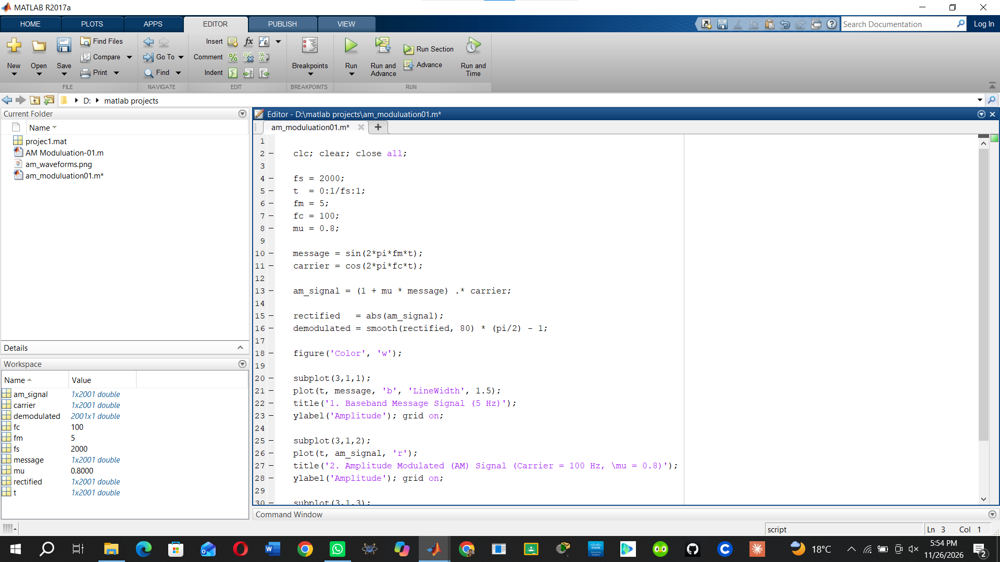
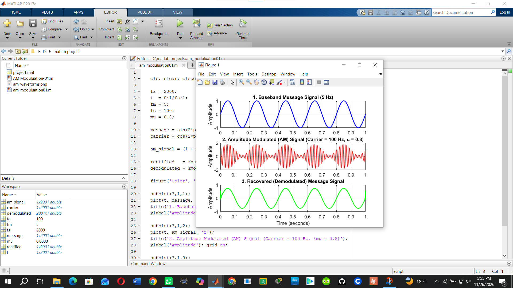

# Amplitude Modulation (AM) & Envelope Detection in MATLAB

### Project Overview
This project simulates **Double-Sideband Full Carrier (DSB-FC) Amplitude Modulation** 

---

### Simulation Results & Waveforms

#### 1. MATLAB Implementation & Setup

#### 2. Baseband, Modulated & Demodulated Waveforms

* **Modulation Index ($\mu = 0.8$):** Keeping $\mu < 1$ ensures the carrier envelope accurately mirrors the $5\text{ Hz}$ sinusoidal message without phase reversal or over-modulation distortion.
* **Envelope Recovery:** Full-wave rectification (`abs`) combined with low-pass smoothing suppresses the $100\text{ Hz}$ carrier ripple while preserving the baseband message shape.

---

### How to Run
1. Open `am_moduluation01.m` in MATLAB.
2. Press **F5** (or click **Run**) to generate the time-domain plots.
